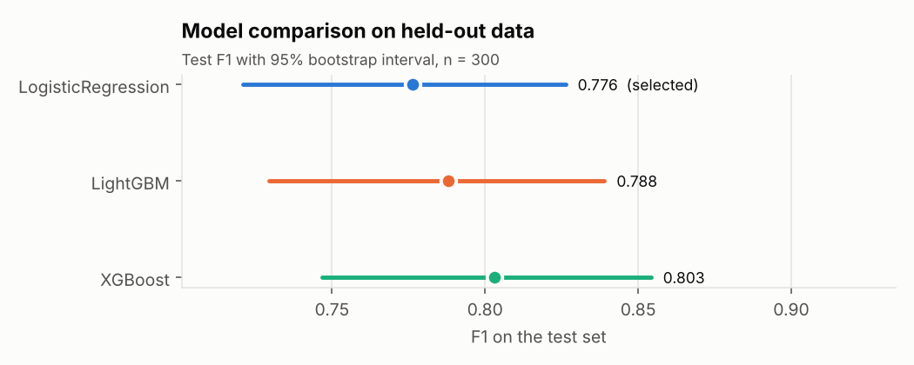
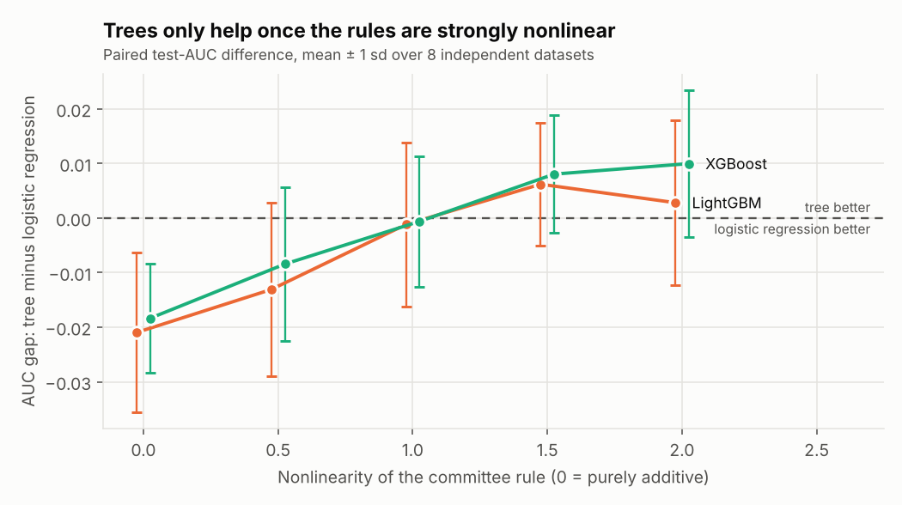

# invest-agents

Agentic multicriteria investment decision. Three LangGraph agents screen a pool of investment
projects, score each one with a supervised model (with SHAP explanations), rank the pool with
AHP + TOPSIS, and return a verdict (INVEST / REVIEW / REJECT) under an explicit, editable policy.

> **Read this first.** All data is **synthetic**, produced by a documented generator
> (`src/invest_agents/data.py`). Every number below describes that simulation, not real-world
> performance. The agents call **no LLM**: they are deterministic and reproducible, with a hook
> (`rationale_fn`) if you want an LLM to word the explanations.

## How it works

```
projects (8 criteria)
   |
   v
[ingestion agent]  validate each record (range, missing, duplicate id); report, don't crash
   |
   v
[analysis agent]   P(invest) from the trained model + the SHAP drivers behind it
   |
   v
[decision agent]   AHP weights -> TOPSIS rank -> rank stability under weight uncertainty
                   -> verdict from DecisionPolicy (thresholds + compliance knockout)
   |
   v
typed JSON result with rationale and an audit trace
```

Criteria: `rentabilite`, `risque`, `delai`, `impact`, `cout`, `liquidite`, `maturite`,
`conformite` (benefit/cost direction in `config.py`).

## Quickstart

Python 3.12+.

```bash
pip install -e ".[dev]"
invest-pipeline                              # generate, ETL, train, validate, report (~15 s)
pytest -q                                    # 85 tests
uvicorn invest_agents.api:app --port 8000    # API  (docs at /docs)
invest-ui                                    # Streamlit UI
invest-experiments                           # when do trees beat logistic regression?
```

API call:

```bash
curl -s localhost:8000/decide -H 'Content-Type: application/json' -d '{
  "projects": [
    {"project_id": "A", "rentabilite": 22, "risque": 35, "delai": 18, "impact": 70,
     "cout": 12, "liquidite": 60, "maturite": 70, "conformite": 85},
    {"project_id": "B", "rentabilite": 9, "risque": 80, "delai": 40, "impact": 30,
     "cout": 80, "liquidite": 20, "maturite": 40, "conformite": 55}
  ],
  "policy": {"invest_proba": 0.6, "min_conformite": 40}
}'
```

Bad records are reported in `ingestion.rejected`; fewer than 2 valid projects gives a 422 that says
why. `/health`, `/ready` and `/model-info` complete the API.

Docker: `docker build -t invest-agents .` then `docker run -p 8000:8000 invest-agents`
(UI: `docker run -p 8501:8501 invest-agents invest-ui --server.address 0.0.0.0`).
**The image has not been built** (no Docker daemon where this was written); the same steps were
run in a clean virtualenv instead (see the build commit).

## Results (full run: seed 42, 2,000 projects)

Full tables and figures: [`reports/results.md`](reports/results.md).

**Data and split.** 2,030 raw rows -> 25 duplicates and 5 schema violations removed -> 2,000
projects, stratified 70/15/15 (1,400 / 300 / 300). Imputation and scaling are fitted inside each
CV fold.

**Models.** Randomized search (20 candidates, 5-fold CV, log-loss) on train; F1 threshold chosen
on validation; test used once; 2,000 bootstrap resamples.

| Model | Test F1 [95% CI] | Test AUC | ΔF1 vs logistic regression [95% CI] |
|---|---|---|---|
| Logistic regression | 0.776 [0.721, 0.826] | 0.896 | baseline |
| LightGBM | 0.788 [0.730, 0.839] | 0.910 | +0.011 [-0.032, 0.053] |
| XGBoost | 0.803 [0.747, 0.854] | 0.906 | +0.026 [-0.014, 0.067] |

The intervals overlap heavily and every paired difference straddles 0: **the data cannot
separate the models**, so the parsimony rule keeps logistic regression. The choice is also
fragile: with a smaller search budget (10 candidates, 500 resamples) the same rule selected
LightGBM instead. Treat the models as equivalent here.



**When do trees help?** `invest-experiments` sweeps how nonlinear the committee rule is, over 8
independent datasets per level, with fixed hyper-parameters:

| Rule | Paired test-AUC gap, tree minus logistic regression |
|---|---|
| purely additive (0) | about -0.02 (trees lose) |
| default (1) | about 0.00 (tie) |
| strong (2) | about +0.01 (XGBoost), +0.003 (LightGBM) |

Trees only pay off when the underlying rules are strongly nonlinear, and even then the gain is
small relative to seed-to-seed spread. See [`reports/nonlinearity_study.md`](reports/nonlinearity_study.md).



**Rankings checked against the truth.** Because the data is synthetic, the noise-free committee
utility is a ground truth. Over 200 random pools of 12 held-out projects:

| Method | Spearman with the true utility | True rank of its top pick (1 = best, random = 6.5) |
|---|---|---|
| ML P(invest) | 0.91 | 1.30 |
| AHP + TOPSIS | 0.71 | 2.32 |

The model captures the knockout rules that a linear-in-criteria TOPSIS cannot. The default AHP
weights are illustrative placeholders (consistency ratio 0.010), not expert judgments.

## Design choices

- **No preprocessing leakage:** imputer and scaler live inside the model pipelines; ETL removes
  duplicates before splitting and asserts that no id or feature vector crosses splits.
- **Fair comparison:** every model gets the same CV search and the same validation-chosen
  threshold; the test set is used once; F1 differences come with paired bootstrap intervals.
- **Explainability that adds up:** SHAP values are tested to sum to each model's raw output.
- **Policy as data:** thresholds and the compliance knockout are a validated `DecisionPolicy`;
  the verdict rule is a pure function with unit tests.
- **Robustness of the ranking:** a Monte Carlo over Dirichlet-perturbed weights gives each
  project a rank mean/std, and flags rationales when the rank is weight-sensitive.
- **TOPSIS is relative to the pool:** scores change if the pool changes. This is inherent to the
  method and stated in `mcda.py`.

## Limitations

- Synthetic data, so no claim about real investment performance. To use real data, provide a CSV
  with the same columns as `data/projects_raw.csv` and run the ETL and training steps.
- The test split has 300 rows, so F1 intervals are wide (about ±0.05).
- AHP priorities are placeholders; elicit them from the people who own the decision.
- Selection among near-equivalent models is sensitive to the search budget (see above).

## Layout

```
src/invest_agents/
  config.py       criteria, bounds, seeds, paths      data.py         synthetic generator + DGP
  schemas.py      Pydantic schemas (3 strictness)     etl.py          clean, validate, split
  modeling.py     CV, thresholds, bootstrap, SHAP     scoring.py      inference + local drivers
  mcda.py         AHP, TOPSIS, weight sensitivity     agents.py       LangGraph workflow
  api.py          FastAPI                             ui.py           Streamlit
  pipeline.py     end-to-end + ranking validation     experiments.py  nonlinearity study
tests/            85 tests (unit, integration, API, UI smoke)
reports/          generated results, figures and metrics (committed)
data/, artifacts/ regenerable (gitignored)
```
