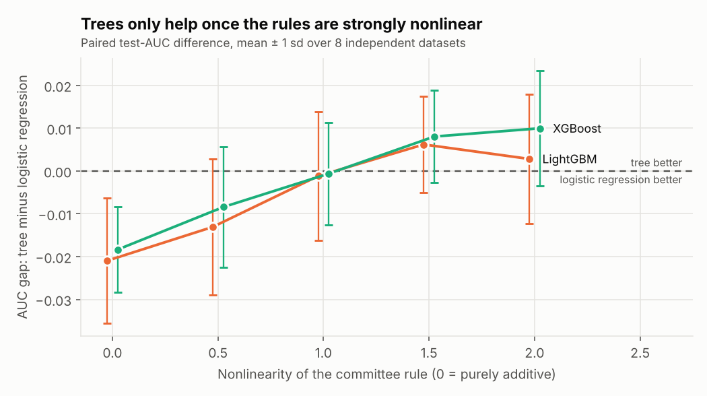

# When do trees beat logistic regression?

Auto-generated by `python -m invest_agents.experiments`. Synthetic data.

5 nonlinearity levels x 8 independent datasets, three models with fixed hyper-parameters (no tuning), identical splits for all models.

| Nonlinearity | LR AUC | LightGBM AUC | XGBoost AUC | ΔAUC LightGBM-LR (mean ± sd, share of seeds > 0) | ΔAUC XGBoost-LR |
|---|---|---|---|---|---|
| 0 | 0.894 | 0.874 | 0.876 | -0.021 ± 0.015, 12% | -0.018 ± 0.010, 12% |
| 0.5 | 0.895 | 0.882 | 0.886 | -0.013 ± 0.016, 25% | -0.008 ± 0.014, 50% |
| 1 | 0.893 | 0.892 | 0.893 | -0.001 ± 0.015, 25% | -0.001 ± 0.012, 38% |
| 1.5 | 0.887 | 0.893 | 0.895 | +0.006 ± 0.011, 88% | +0.008 ± 0.011, 88% |
| 2 | 0.886 | 0.889 | 0.896 | +0.003 ± 0.015, 62% | +0.010 ± 0.013, 75% |

