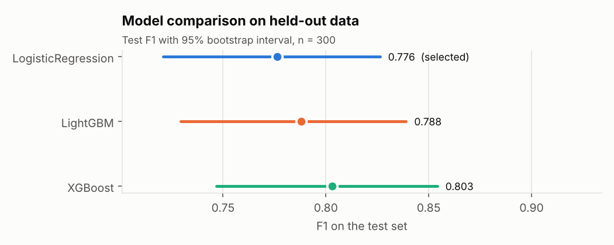
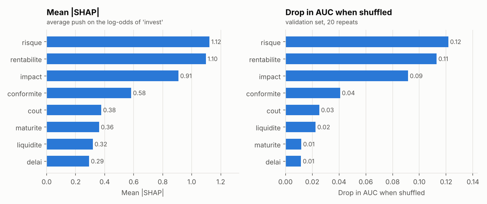

# Results

Auto-generated by `python -m invest_agents.pipeline`. Synthetic data: these numbers describe the simulation, not real-world performance.

Run: seed 42, nonlinearity 1.0, 2000 projects.

## Data and ETL

- Raw rows: 2030; duplicates dropped: 25; schema rejections: 5; clean projects: 2000.
- Stratified split: 1400 train / 300 validation / 300 test (invest rate 0.45 / 0.45 / 0.45).
- Missing values (share): rentabilite 2.0%, delai 2.0%, liquidite 2.0%, maturite 2.0%.

## Models

Randomized search, 20 candidates x 5-fold CV on train (log-loss); F1 threshold chosen on validation; test used once; 2000 bootstrap resamples.

| Model | CV log-loss | Val F1 | Test F1 [95% CI] | Test AUC | Brier | ΔF1 vs baseline [95% CI] | P(better) |
|---|---|---|---|---|---|---|---|
| LogisticRegression | 0.394 | 0.773 | 0.776 [0.721, 0.826] | 0.896 | 0.133 | baseline | - |
| LightGBM | 0.398 | 0.777 | 0.788 [0.730, 0.839] | 0.910 | 0.122 | +0.011 [-0.032, 0.053] | 0.71 |
| XGBoost | 0.397 | 0.779 | 0.803 [0.747, 0.854] | 0.906 | 0.124 | +0.026 [-0.014, 0.067] | 0.89 |

**Selected: LogisticRegression.** No model beat the baseline validation F1 (0.773) by more than 0.01; simpler model kept.

A model is only better than the baseline if the interval for its F1 difference excludes 0. Intervals that straddle 0 are noise at this test size.

## What drives the decision

| Criterion | Mean abs SHAP | AUC drop when shuffled |
|---|---|---|
| risque | 1.123 | 0.122 |
| rentabilite | 1.097 | 0.113 |
| impact | 0.908 | 0.092 |
| conformite | 0.583 | 0.041 |
| cout | 0.377 | 0.025 |
| maturite | 0.362 | 0.012 |
| liquidite | 0.318 | 0.022 |
| delai | 0.293 | 0.012 |

## Ranking validation against the true utility

Over 200 random pools of 12 held-out projects. The truth is the noise-free committee utility from the data generator, available only because the data is synthetic.

| Measure | Mean | 5th-95th percentile |
|---|---|---|
| Spearman: AHP+TOPSIS vs truth | 0.71 | 0.41 to 0.92 |
| Spearman: ML P(invest) vs truth | 0.91 | 0.78 to 0.99 |
| Spearman: AHP+TOPSIS vs ML P(invest) | 0.77 | 0.44 to 0.94 |
| True rank of TOPSIS top pick (1 = best) | 2.32 | 1.00 to 7.05 |
| True rank of ML top pick (1 = best) | 1.30 | 1.00 to 3.00 |

A random pick would have true rank 6.5 on average.

## AHP weights

Consistency ratio 0.010 (acceptable below 0.10). The priorities are illustrative placeholders, not elicited from experts.

| Criterion | Weight |
|---|---|
| rentabilite | 0.217 |
| risque | 0.198 |
| impact | 0.155 |
| cout | 0.114 |
| delai | 0.094 |
| conformite | 0.094 |
| liquidite | 0.079 |
| maturite | 0.049 |
